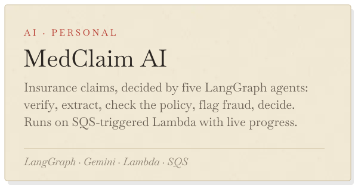
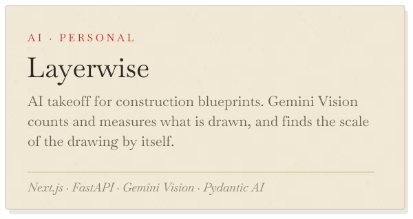
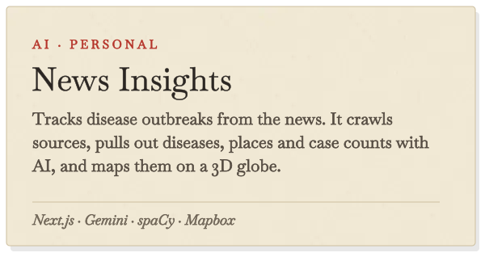
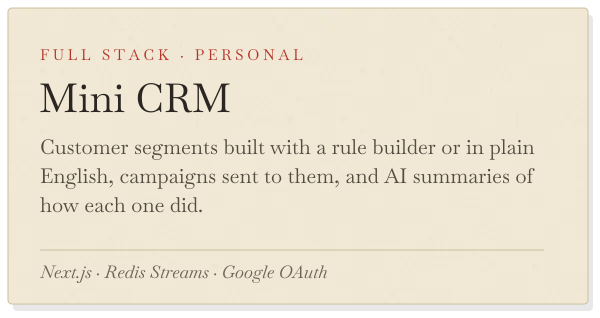
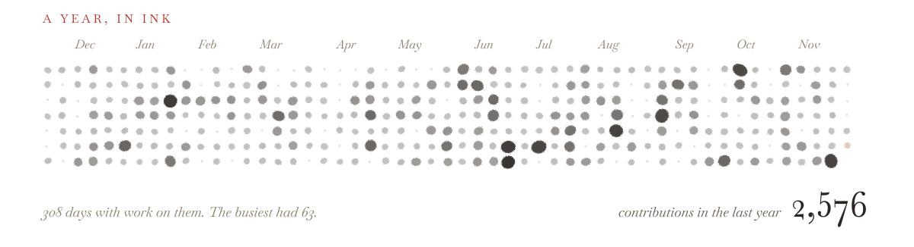
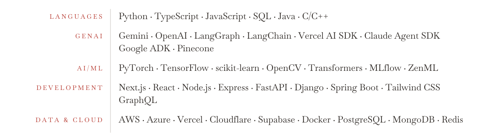

<a href="https://www.harshbanka.tech"><picture><source media="(prefers-color-scheme: dark)" srcset="assets/hero-dark.svg"></picture></a>

 

<picture><source media="(prefers-color-scheme: dark)" srcset="assets/work-dark.svg"></picture>

  <a href="https://github.com/LordHarsh/medclaim-ai"><picture><source media="(prefers-color-scheme: dark)" srcset="assets/card-medclaim-dark.svg"></picture></a>
  <a href="https://github.com/LordHarsh/layerwise.ai"><picture><source media="(prefers-color-scheme: dark)" srcset="assets/card-layerwise-dark.svg"></picture></a>

  <a href="https://github.com/LordHarsh/news-bug"><picture><source media="(prefers-color-scheme: dark)" srcset="assets/card-newsbug-dark.svg"></picture></a>
  <a href="https://github.com/LordHarsh/crm-xeno"><picture><source media="(prefers-color-scheme: dark)" srcset="assets/card-crm-dark.svg"></picture></a>

<picture><source media="(prefers-color-scheme: dark)" srcset="assets/year-dark.svg"></picture>

<picture><source media="(prefers-color-scheme: dark)" srcset="assets/stack-dark.svg"></picture>

  <a href="https://www.harshbanka.tech">Portfolio</a> &nbsp;·&nbsp;
  <a href="https://www.linkedin.com/in/harsh-banka">LinkedIn</a> &nbsp;·&nbsp;
  <a href="https://www.harshbanka.tech/Harsh_Kumar_Banka_Resume.pdf">Resume</a>

The same, in plain text

**Harsh Kumar Banka.** Software Engineer at Quinence. I build AI agents and the production systems behind them.

**Quinence**, Software Engineer, Jun 2026 to present

- Built Halocard: spend crypto with a Visa card. KYC, card issuing and deposits, live in production.
- A multi-tenant MCP server, so each customer of a B2B platform can query their own data from Claude or ChatGPT.
- An AI support agent on Claude Code that traces tickets to their root cause.

**EmendoAI**, Software Engineer (AI/ML), Oct 2024 to May 2026

- AI agents and a Gemini document pipeline for a construction platform.
- An LLM test framework: regression tests across 10+ features, with no manual work.
- 200+ Lambda functions across 35 AWS CDK stacks, in production.

**Research and wins**, NIT Trichy, and two hackathons

- Pose estimation research at NIT Trichy: HRNet and FiDIP, to monitor infant motor skills.
- First place, CodeFest Hackathon 2024, with an AI interview system.
- First place, DigiZest Hackathon 2023, with home automation you run by talking to an LLM.

**Things I built**

- [MedClaim AI](https://github.com/LordHarsh/medclaim-ai): Insurance claims, decided by five LangGraph agents: verify, extract, check the policy, flag fraud, decide. Runs on SQS-triggered Lambda with live progress.
- [Layerwise](https://github.com/LordHarsh/layerwise.ai): AI takeoff for construction blueprints. Gemini Vision counts and measures what is drawn, and finds the scale of the drawing by itself.
- [News Insights](https://github.com/LordHarsh/news-bug): Tracks disease outbreaks from the news. It crawls sources, pulls out diseases, places and case counts with AI, and maps them on a 3D globe.
- [Mini CRM](https://github.com/LordHarsh/crm-xeno): Customer segments built with a rule builder or in plain English, campaigns sent to them, and AI summaries of how each one did.

**What I work with**

- Languages: Python, TypeScript, JavaScript, SQL, Java, C/C++
- Genai: Gemini, OpenAI, LangGraph, LangChain, Vercel AI SDK, Claude Agent SDK, Google ADK, Pinecone
- Ai/ml: PyTorch, TensorFlow, scikit-learn, OpenCV, Transformers, MLflow, ZenML
- Development: Next.js, React, Node.js, Express, FastAPI, Django, Spring Boot, Tailwind CSS, GraphQL
- Data & cloud: AWS, Azure, Vercel, Cloudflare, Supabase, Docker, PostgreSQL, MongoDB, Redis

  The landscape is a painting from The Metropolitan Museum of Art, public domain. The bird and her plum branch were painted with a Gemini image model. 
  The type is Baskervville (OFL). Everything here is drawn by <a href="scroll/build.py">a script in this repository</a>, and the year of ink is redrawn every day.

